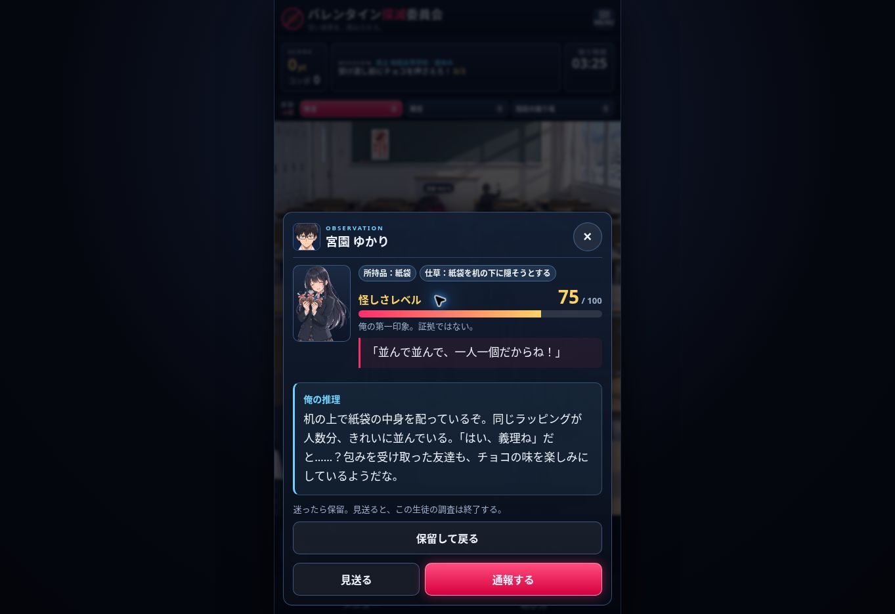

# アワード応募に向けた推理・読みやすさ改善（2026-11-11）

ゲーム内容のバージョン：**0.2.0**。設定画面で確認できる。

## 変更内容

| 項目 | 修正後の挙動 |
| --- | --- |
| 怪しさ表示 | 「怪しさレベル」に統一し、ラベル16px・数値28pxを基準に拡大。第一印象であることを補足 |
| 数値による正解の漏れ | 全3周・全43人を35/55/75に再配分。各周の各数値にチョコ所持者と無実の生徒が混在 |
| 観察メモ | 箇条書きを廃止し、「俺の推理」の一続きの独白に変更。3/2/1件の開示制限は維持 |
| 関係性の推理 | サッカー部のエースへの好意、別クラスの男子との行動等を一部に追加。恋愛の噂だけで断定せず持ち物や行動と照合 |
| 文字サイズ | 推理・セリフ・捜索結果・生徒指導・双眼鏡の文章を17px基準にし、設定の「大」「特大」にも対応 |
| 机の捜索 | 捜索前にリボンやパンの包み等の推理を提示。発見後は主人公の発見・報告のセリフに変更し、後出しの「手がかり」を撤去 |
| 頭上マーカー | チョコ所持を示唆していた「!」と旧判定ロジックを削除 |
| 横断幕 | 全エリアから横断幕を撤去。教室の小さな菓子禁止ポスターは維持 |
| 双眼鏡 | 自動終了を廃止。「観察に戻る」を押すまで文章を表示し、その間のタイマーを停止。使用時の15秒消費は維持 |
| 判断の保留 | 「保留して戻る」を追加。見送ると調査終了になる旨を事前に表示し、見送り後は台詞で通知 |
| 振り返り | 通報結果で実際に読んだ推理だけを確認可能。ステージ結果で正しく見送った数・見逃した数と理由を表示 |
| 遊び方 | タイトルとステージから開ける説明と2問の判断練習を追加。高い数値の無実／低い数値の所持者を体験 |
| タイマー | メニュー・遊び方・別タブ等の非表示中は停止。開発用の手動停止とは独立 |
| ナビゲーション | 動作しない項目を除き、メニュー／遊び方の2項目に整理 |
| エンディング | 誤認ゼロのDで誤認連発と叱らない。Cの囮人数を実績に合わせる。ランクの結末を先に表示して特殊後日談へ進む |
| 終了条件 | 最後の机を調べた後や残り時間ゼロの捜索結果を閉じた時、適切にステージ結果へ移る |

## 10月30日の作業と今回の変更の区別

ユーザーが共有した会話には、人物素材107点の確認、66点の背景残り修正、9点の照合保留、テスト103件成功という報告がある。最後の文章は「変更をPRにまとめています」で、完了したコミットIDやPR番号は示されていない。

2026-11-11の調査時点で確認したGitHub mainは `427e09e68256cb72330ae7b8f7eb654993fdf502`（2026-10-22）。確認できたブランチ・PR・保存ファイルから、上記66点の画像修正データと9点の保留一覧は回収できなかった。**消失を断定するものではない。** ChatGPT側の会話エラーも、GitHubへの保存成否を証明するものではない。

- 双眼鏡の手動確認は、会話に記載された要件に従って今回再実装した。
- **人物画像のバイト列は今回変更していない。66点の透過修正を反映済みとは扱わない。**
- 元の修正ファイルまたは元画像を回収できた時に、対応表・色・寸法・透過を比較して別途統合する。9点の対象名は未確認なので推測で補っていない。
- mainに残っていた横断幕を今回削除した。過去のChatGPTで削除済みだったかは、この調査だけでは確定できない。

## 既存PRとの関係

このブランチはPR #4の `687151cec1588542860d097e47860d31af639998` を基点にし、PR #3のプライバシーポリシー整合修正とPR #4のアプリ内閲覧機能を維持する。古い画面を含むPR #2のスクリーンショットは取り込んでいない。

この変更のコミット・PR作成と、mainへの統合／公開は別工程。既存の公開ゲームにこの版が反映されたかは、公開先の設定画面とデプロイ結果で確認する。

## 検証

- Vitest：**135件成功**（14ファイル）。数値の正解漏れ、非公開ヒントの漏れ、保留／見送りの差、重複操作防止、各停止条件、双眼鏡の継続、捜索時間、結末の整合等。
- TypeScript型チェック、本番ビルド成功。
- Web配布物の検証：3件成功。Android梱包スクリプトの検証：8件成功。
- ブラウザ操作：判断練習2問、3周目の観察と双眼鏡、確認ボタンで復帰、通報結果、机の事前推理と発見後の台詞、メニューのタイマー停止を確認。
- 双眼鏡は30秒以上経過後も文章が残り、使用時の15秒消費後の残り時間が変わらないことを確認。
- 320×568 CSS px・文章「特大」で、観察と机の長文が横にはみ出さず、スクロールして操作ボタンまで到達できることを確認。
- iPhone/Android実機、ストア用の新AAB/IPA、全9ステージの通しプレイは今回未実施。既存の画像透過の未回収分は残る。
