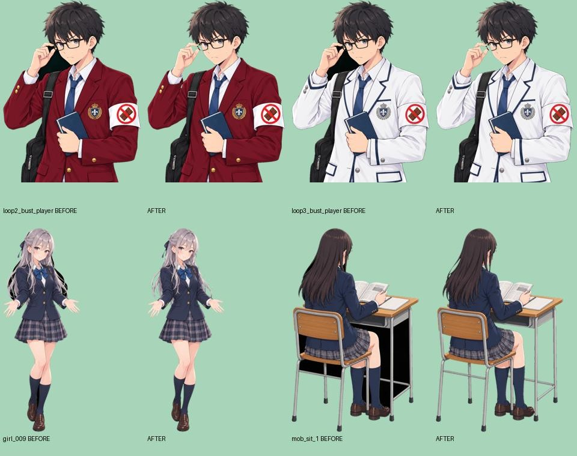

# 人物素材の透過修正（v0.2.2 / 2026-11-12）

手と顔に囲まれた黒い背景が残っていた2・3周目の主人公を修正した。人物素材107点を点検し、原稿と一致した79点の背景の取り残しを除去。19点は今回と同じ明確な取り残しを目視で認めず、9点は原稿の版違い・欠損により未修正として記録した。**107点すべて修正済みという意味ではない。**

## 原因と修正

元の処理は緑背景のうち画像外周につながる領域だけを透明にしていた。手・顔・髪・鞄・机・椅子に囲まれた緑が残り、その後の緑かぶり除去で黒くなっていた。

- 元の緑背景原稿から、閉じた背景領域も含めた透明度を計算。
- 元の輪郭と現行素材の透明度が一致することを検証し、対象を限定。
- 色データは再描画・再圧縮せず、WebPの透明度チャンクだけを交換。全79点で圧縮済みの色データ、展開後のRGB値、画像寸法が修正前と完全一致することを検証。
- 現行素材の外周や配置・表示サイズは維持。透明度を増やす変更はしない。
- 主人公2・3周目の手と顔／指の隙間、女子生徒の髪・腕・鞄の間、モブの脚・鞄・机・椅子の隙間を修正。
- 家具付き着席モブ3点も素材自体を修正したが、v0.2.1で外した教室への配置は復活させていない。

画像生成による試作5点は採用していない。ユーザーが選択した「透過だけを加工」に従い、すべて現行の絵を維持している。

## 点検結果

| 区分 | 点数 | 扱い |
| --- | ---: | --- |
| 原稿と一致し、透過を修正 | 79 | ゲーム用素材へ反映 |
| 今回と同じ明確な取り残しを目視で認めず | 19 | 画像は変更せず |
| 原稿の版違い・欠損で保留 | 9 | 元の画像を維持。修正済みに含めない |
| 合計 | 107 | 全人物WebPを一覧・拡大で点検 |

全ファイルの判定、原稿名、修正前後のSHA-256、透明度の変更画素数は [点検台帳](character-alpha-audit-20261112.json) に記録。

## 未修正の9点

| ゲーム素材 | 理由 |
| --- | --- |
| `loop2_girl_01.webp` | 回収原稿と現行素材の輪郭・色が一致しない |
| `loop2_girl_03.webp` | 回収原稿と現行素材の輪郭が一致しない |
| `loop2_girl_07_turn.webp` | 回収した振り向き原稿と現行素材の構図・輪郭が一致しない |
| `loop3_girl_01.webp` | 回収原稿と現行素材の輪郭・色が一致しない |
| `loop3_girl_03.webp` | 回収原稿と現行素材の輪郭が一致しない |
| `loop3_girl_07_turn.webp` | 回収した振り向き原稿と現行素材の輪郭が一致しない |
| `loop3_girl_08_turn.webp` | 回収した振り向き原稿と現行素材の輪郭が一致しない |
| `loop3_girl_09_turn.webp` | 素材ZIPの途中欠損により、当該PNGを完全に復元できない |
| `loop3_girl_10_turn.webp` | 素材ZIPの欠損部分に含まれ、当該PNGを回収できない |

この9点にも髪まわり等に残りが疑われる箇所がある。対応する原稿を確保するか、個別の手作業マスクを確認してから追加修正する。黒色の一括削除や別制服の輪郭流用は行っていない。今回特定した9点であり、10/30の会話で言及された「保留9点」と同一だとは断定しない。

## 再現と検証

- `scripts/repair_character_alpha.py --sources <原稿の展開先>`：台帳で確認済みの原稿と修正前ファイルだけを処理。修正済みはスキップ。原稿の欠落・ハッシュ不一致・輪郭不一致は書き込み前に停止。
- 元の素材ZIP一覧：[参照元](character-alpha-source-packs.json)。破損ZIP `girls_turn_06_10.zip` はローカルヘッダーとCRCを検証して8枚の完全なPNGを復元。欠損した末尾2枚は処理しなかった。
- 透過修正のテスト4件：閉じた緑背景の除去、黒い描画の保持、版違い・寸法違いの拒否、圧縮済み色データの完全保持。
- 全79点のRGB・寸法・色チャンク一致と透明度の減少のみであることを比較確認。全修正画像を明るい背景に重ねて目視確認。
- 既存ゲームテスト・本番ビルド・Web配布物検証の結果はPRに記録。

GitHubのPR #5と非公開の確認版に反映する変更。mainへの統合やストア向け署名済みAAB/IPAの更新とは別工程。
