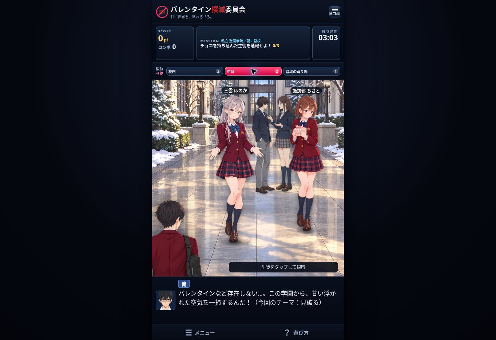
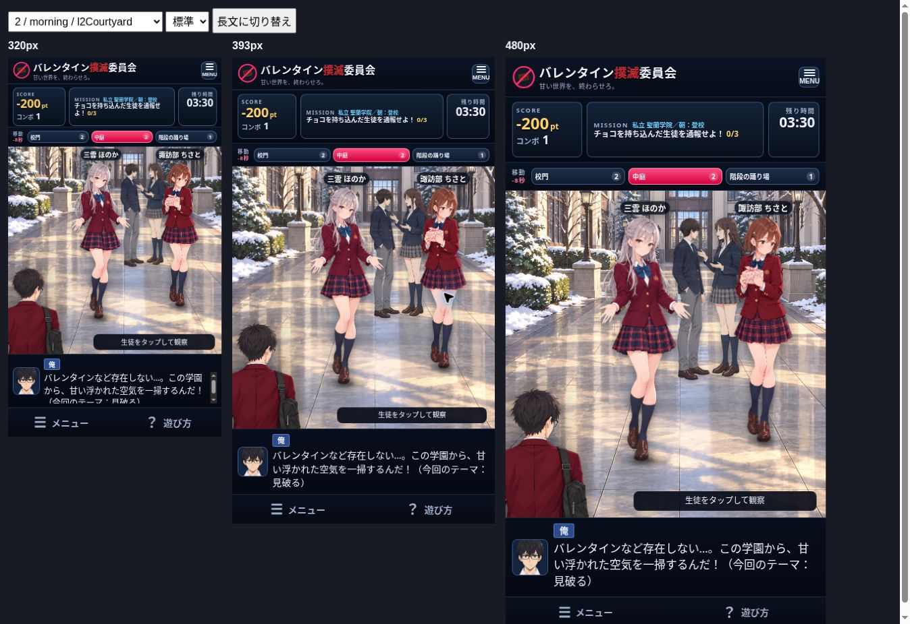

# 生徒の観察エリアと配置の修正（v0.2.4）

## ユーザーの意図
ゲーム画面の広さを確保したまま、生徒とモブを背景に見合う大きさへ調整する。画面を狭めて人物が大きく見える状態にはしない。名前、顔、持ち物が前景の主人公や画面端で隠れないこと。

## 修正
- ゲーム枠の幅を文字サイズの基準にし、HUD・エリア切り替え・セリフ・ナビの高さを安定させた。ナビは横並び44px。長文・文字設定で観察エリアが縮まない。
- 主人公のセリフは枠内でスクロールできる。文が切り替わると先頭へ戻る。観察モーダルなどの拡大文字は維持。
- 前景の主人公は幅47%から33%にして、左の生徒の顔・持ち物・足元を見せる。生徒は足元のY座標を保ち、左右の位置を調整した。
- 全43人で頭上8%以上の名前用余白を確保。拡大前の基準に対し人物の高さは17.6〜25%大きい状態を維持。モブも共通の拡大計算を継続。
- 2・3周目の中庭の会話モブを右奥へ配置。名前ラベルを拡大し、小画面で名前同士が重なる教室・購買などを個別に調整。
- 「生徒をタップして観察」は右下の一行に戻した。
- スコア列の幅を確保し、5桁以上は文字サイズを調整。

## 最終検証
- npm test: 15ファイル・138件成功（配置の回帰テスト3件を含む）。
- npm run build: 型チェック・本番ビルド成功。
- npm run verify:web: 本番バンドルの3件テスト成功。
- 全28場面・43人を320 / 393 / 480px幅でブラウザ確認（計84レイアウト）。名前の枠外表示、名前同士の重なり、前景主人公との観察対象の重なりは0件。
- 全28場面の背景と人物の配置をスクリーンショットで確認。
- 標準・大・特大 × 通常文・長文 × 3画面幅の18条件で、観察エリアの高さが一定。320px=311.58px、393px=392.70px、480px=489.16px。
- スコア-200、12,345とコンボ12（×2.0）が320pxで枠内に収まることを確認。
- 三雲ほのか（2周目中庭）、皇ゆきの（3周目体育館裏）、月島ふゆ（3周目教室）の観察、1周目教室の机選択を操作確認。長文スクロール後、観察文に切り替わると先頭へ戻ることを確認。
- 通常の開発版を校門から中庭へ移動して最終表示を確認。一時的なQA用ページは本番ビルド前に除外。
- iPhone実機では未検証。ブラウザの画面幅による確認。

## 画面

## 引き継ぎ・公開状態
ブランチ: `codex/restore-stage-space-20261112`、PR #7。main統合・本番公開は未実施（承認待ち）。

再開: `app`で`npm ci`、`npm test`、`npm run build`、`npm run verify:web`。配置は`src/data/students.ts`、共通の身長計算は`src/game/perspective.ts`、画面比率は`src/styles/stage.css`。
